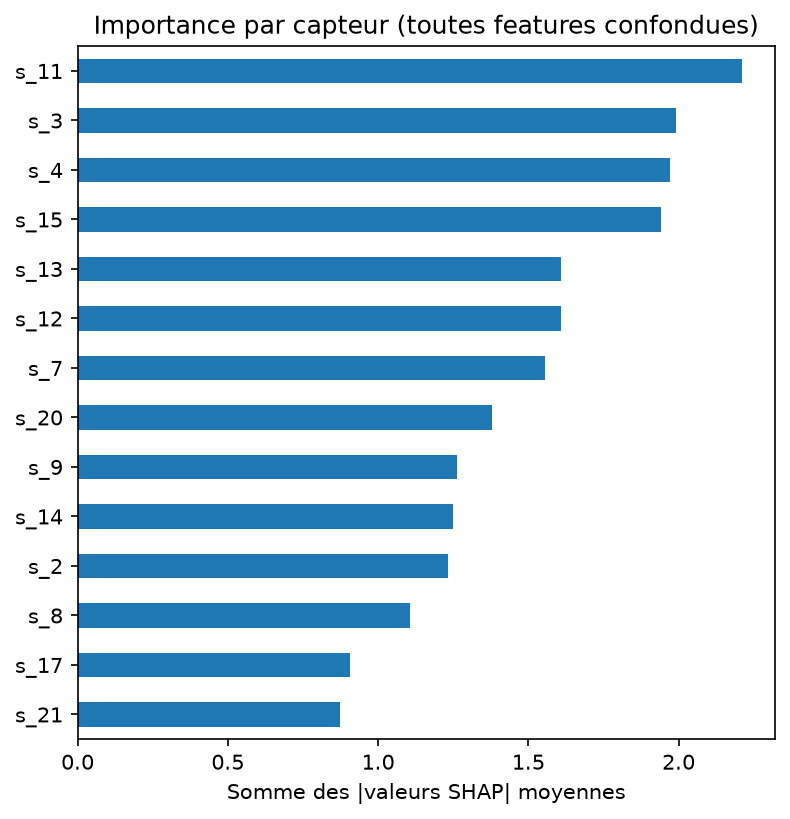
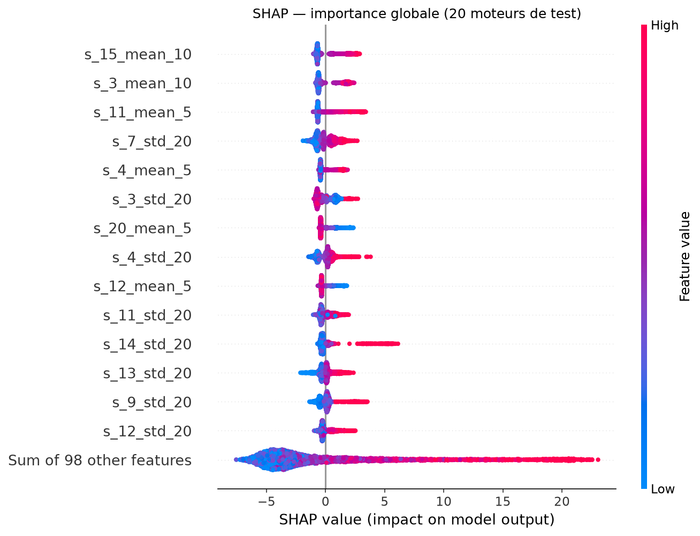
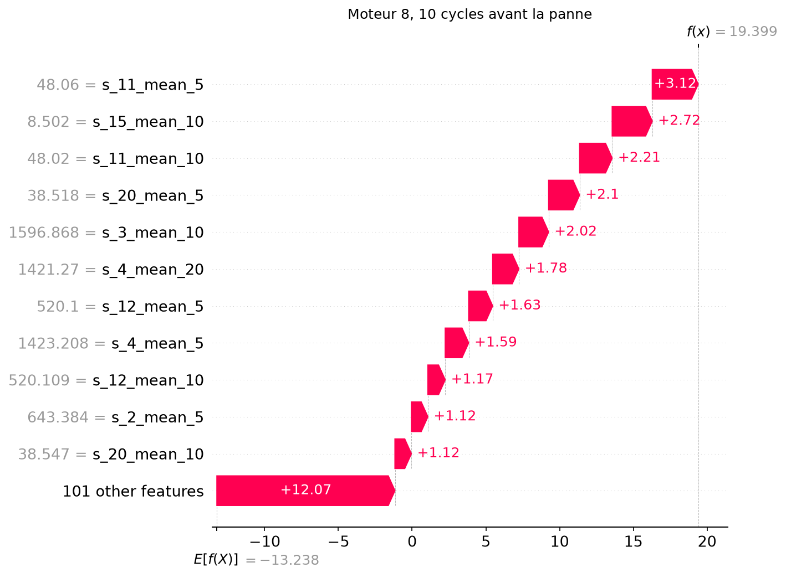

# predictive-maintenance
Prédiction de panne de moteurs à partir de capteurs (NASA C-MAPSS)
## Résultats

Validation croisée groupée (5 plis, 80 moteurs) — features glissantes (fenêtres 5, 10, 20), 112 features.

| Modèle | PR-AUC (CV) | Seuil | Rappel | Précision |
|---|---|---|---|---|
| Baseline (semaine 1, capteurs bruts) | [0.95] | 0,50 | [0.841] | [0.876] |
| Régression logistique | [0.969] ± [0.009] | [0.19] | [0.977] | [0.748] |
| Random Forest | [0.954] ± [0.013] | [0.23] | [0.980] | [0.661] |
| LightGBM | [0.961] ± [0.011] | [0.01] | [0.957] | [0.753] |
| LightGBM optimisé (Optuna, 30 essais) | [0.964] ± [-] | [0.01] | [-] | [-] |

**Évaluation finale (20 moteurs jamais vus, mesurée une seule fois)** — LightGBM optimisé :
PR-AUC [0.969], rappel [0.975], précision [0.750], seuil [0.01].

Le seuil minimise un coût où une panne ratée vaut 10 fois une maintenance inutile (hypothèse).

**Limites** : 20 moteurs de test seulement ; données simulées (FD001, une seule condition de vol) ; coût compté par cycle et non par moteur.

## Installation (Linux / WSL2)

    python3 -m venv .venv
    source .venv/bin/activate
    pip install -r requirements.txt
    pre-commit install

Placer `train_FD001.txt`, `test_FD001.txt` et `RUL_FD001.txt` (NASA C-MAPSS) dans `data/raw/`.

## Commandes

| Action | Commande |
|---|---|
| Tests | `python -m pytest` |
| Comparer les modèles | `python -m src.models.train` |
| Tuning LightGBM | `python -m src.models.tune --n-trials 30` |
| Évaluation finale | `python -m src.models.evaluate --model lightgbm --params configs/lightgbm_best.yaml` |
| Interprétabilité SHAP | `python -m src.evaluation.explain` |
| Interface MLflow | `mlflow ui --backend-store-uri sqlite:///mlflow.db` |
| Image Docker | `docker build -t predictive-maintenance:0.2.0 .` |
| Lancer l'API | `docker run --rm -p 8000:8000 predictive-maintenance:0.2.0` |

## Interprétabilité (SHAP)

Valeurs SHAP calculées avec `TreeExplainer` sur les 20 moteurs de test (`python -m src.evaluation.explain`). Pour LightGBM, elles sont exprimées en log-odds : une valeur positive pousse la prédiction vers « panne dans les 30 cycles », une valeur négative l'en éloigne.

- **Capteurs dominants.** En regroupant toutes les features d'un même capteur, les plus influents sont **s_11**, **s_3** et **s_4**, suivis de près par **s_15**. C'est cohérent avec l'exploration initiale : ce sont des capteurs qui augmentent nettement à l'approche de la panne. Les moins influents (s_21, s_17) restent utiles, mais avec un poids environ deux fois plus faible.
- **Features glissantes.** Aucune valeur brute de capteur n'apparaît parmi les 15 features les plus importantes : le classement est entièrement composé de moyennes glissantes (`s_15_mean_10`, `s_3_mean_10`, `s_11_mean_5`…) et d'écarts-types sur 20 cycles (`s_7_std_20`, `s_3_std_20`…). Le lissage fait ressortir la tendance de dégradation, et l'écart-type capte l'instabilité croissante du moteur en fin de vie. Cela confirme l'intérêt des features ajoutées en semaine 2.
- **Sens des effets.** Pour s_15, s_3, s_11 et s_4, les valeurs élevées (en rouge) sont à droite : quand ces capteurs augmentent, le risque monte. À l'inverse, pour s_20 et s_12, ce sont les valeurs faibles (en bleu) qui poussent vers la panne : ces capteurs diminuent avec la dégradation. Les écarts-types élevés augmentent aussi le risque : un moteur proche de la panne est plus instable.
- **Exemple d'un moteur.** Pour le moteur 8, 10 cycles avant sa panne, la prédiction passe de la valeur de base (−13,2) à 19,4, soit une probabilité de panne quasi certaine. Les principales contributions viennent de la moyenne de s_11 sur 5 cycles (+3,1, valeur élevée de 48,06), de la moyenne de s_15 sur 10 cycles (+2,7) et de la moyenne de s_20 sur 5 cycles (+2,1, valeur basse de 38,52). L'essentiel du risque reste cependant réparti sur une centaine d'autres features (+12,1 au total).
- **Limites.** Les features d'un même capteur sont très corrélées (moyennes sur 5, 10 et 20 cycles, par exemple). SHAP répartit le mérite entre elles, ce qui dilue l'importance de chacune : c'est visible dans la ligne « Sum of 98 other features » du beeswarm, et c'est pourquoi l'analyse regroupée par capteur est plus fiable. Enfin, SHAP explique le comportement du modèle, pas la physique du moteur : un capteur influent est associé à la panne, sans en être forcément la cause.
